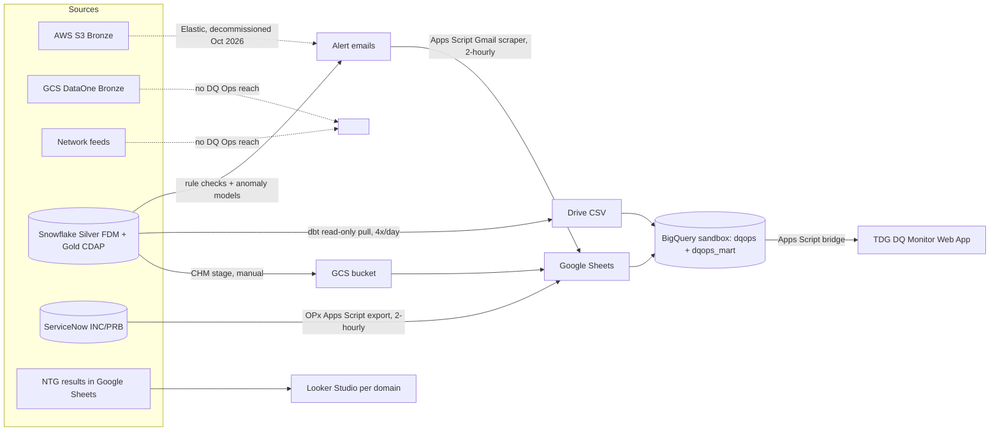
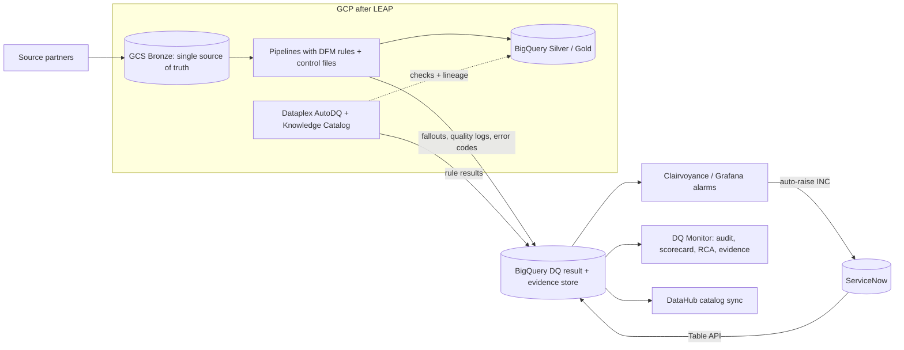

# 03 - Data Estate and Architecture (current and target)

Context file for the DQ tools deep-research brief. It describes the data estate a data quality tool at Globe would have to run on, today and after the LEAP migration.

- **As of:** 2026-10-18.
- **Labels used:** **[CURRENT]** = running today. **[TARGET]** = decided direction, not yet built. **[PROPOSED]** = DQ Ops design or recommendation, not ratified. **[OPEN]** = unresolved.
- **Sources:** internal knowledge base (data estate map, LEAP WS3 distillation, GEDM reference), the DQ Ops target-architecture review, the LEAP DQ requirements shelf, the BigQuery data-layer design, and team memory notes. No credentials, account identifiers, file IDs or internal URLs are included.

---

## 1. The short version

- Globe's estate is **multi-cloud**: raw ingestion on AWS S3, GCP Cloud Storage and network feeds; curated Silver and Gold in **Snowflake**; some Silver processing on **Databricks**.
- **DQ Ops reaches Snowflake only today** (Silver and Gold). It has no direct reach into AWS Bronze, the GCP-resident DataOne dataset, or network feeds.
- The DQ toolchain today is low-cost and Google Workspace-heavy: Snowflake checks and anomaly models emit alerts by email, Apps Script scrapes them into Google Sheets, ServiceNow incidents arrive as a Sheet export, and a dashboard (the TDG Data Quality Monitor) is served as an Apps Script Web App. Since early October 2026 the Monitor reads a **BigQuery sandbox** layer.
- **LEAP**, a 15-month program, is migrating about **3,585 TB** to a federated data mesh on **GCP / BigQuery**. Snowflake Gold is decommissioned first (months 3-4); Snowflake and Databricks are fully decommissioned by months 12-15.
- The TDG head's direction (2026-08-11): **ServiceNow** for incidents, **GCP** as the monitoring project, **BigQuery** for all DQ data, **Clairvoyance (Grafana)** as the mandated observability and alerting tool.
- InfoSec is the binding constraint on tools: **no third-party application may open its own connection to a production database without lengthy approval.** dbt connecting to Snowflake is already approved.

---

## 2. Platforms in the estate

| Platform | Role today | Status after LEAP |
|---|---|---|
| **Snowflake** | Silver (FDM) and Gold (CDAP) warehouse. Two estates: one Gold/consumption account, one Silver/EDO account. Hosts DQ checks, Data Metric Functions, anomaly-detection models and CHM logs. About 230 credits/month spent on DQ checks. | **[TARGET]** Gold decommissioned months 3-4; fully decommissioned months 12-15 |
| **Databricks** | Part of Silver processing (PySpark) | **[TARGET]** Re-platformed to Dataproc Serverless (months 5-8); decommissioned months 12-15 |
| **AWS S3** (with Glue, Lambda) | Bronze raw ingestion | **[TARGET]** ~2,500 TB historical raw moved to GCS (months 9-11) |
| **GCP Cloud Storage ("DataOne")** | Bronze; Globe's largest customer dataset outside network data | Stays; GCS Bronze becomes the single source of truth |
| **GCP BigQuery** | **[CURRENT]** DQ Ops sandbox project (asia-southeast1) holding the Monitor's data layer and the OPx incident dataset | **[TARGET]** Enterprise warehouse for Bronze/Silver/Gold; DQ result-and-evidence store |
| **Dataplex / Knowledge Catalog** | Not in use by DQ Ops | **[TARGET]** LEAP names Dataplex AutoDQ for checks and Knowledge Catalog for column lineage |
| **Google Sheets / Drive / Apps Script / Sites** | The current DQ substrate: alert scraping, enrichment, DQI generation, dashboard serving | **[TARGET]** Sheets survive only as human entry forms; machine data lands in BigQuery |
| **ServiceNow** | System of record for incidents (INC), problems (PRB), requests (RITM), changes (CR). Primary intake for user-raised DQ issues | Stays as incident system of record; **[TARGET]** auto-raised INCs from Clairvoyance |
| **Clairvoyance (Grafana)** | Enterprise-mandated observability tool for data; DQ Ops not yet onboarded | **[TARGET]** Alarms on rule failures and fallouts; auto-raises ServiceNow INCs |
| **Elastic / Kibana** | Was the only Bronze monitor (ingestion dashboard + anomaly detection) | **Decommissioned** from October 2026. No Bronze anomaly flagging until a replacement exists |
| **dbt** | Approved path to Snowflake (read-only pulls, profiling, scheduled exports). Check catalog designed to compile to dbt tests | **[TARGET]** dbt-bigquery adapter named in LEAP Phase 3 |
| **DataHub** | Enterprise metadata and lineage catalog, owned by the infrastructure/governance group. Stalled at 11 of 190 platforms onboarded | **[TARGET]** Bidirectional sync with Knowledge Catalog |
| **Jira / Confluence** | Project tracking and documentation | Unchanged |
| **Looker Studio** | Used by the network DQ team for per-domain dashboards | Dropped from the DQ Ops target |
| **IBM Maximo and network systems** | Network inventory master data (NTG domain) and its sources of truth (NMS, SAP, site/address registers) | Not addressed in LEAP sources reviewed |

---

## 3. Medallion layers: what lives where

| Layer | What it is | Where it lives today | DQ coverage today |
|---|---|---|---|
| **Bronze** | Raw, uncleaned ingestion | AWS S3; GCP Cloud Storage (DataOne); network ingestion feeds (exact landing system unconfirmed) | **Gap.** No direct DQ Ops reach. Elastic was the only window and is now decommissioned |
| **Silver** | Cleaned, conformed facts, dbt-curated | **FDM** (Foundational Data Mart) in Snowflake, the EDO estate; some Databricks | Live: rule checks, anomaly models, CHM logs |
| **Gold** | Consumption marts and KPIs; the source for reports | **CDAP** marts in Snowflake, the consumption estate | Live: anomaly models on report KPIs |

**Scope decision (2026-08-11):** DQ Ops governs **to Silver**. Gold transfers to Data Management through a handover register. This is provisional at the Mancom level and still has an edge-case simulation owed.

---

## 4. Source domains and data

### Commercial / customer analytics (the original scope)
- **KPI families (the "3-parent" roll-up):** Subscriber (live, acquisition, churn), Reload (count, amount, loader), Usages (voice, SMS, data, AAA).
- **Brands:** 9 consumer brands across prepaid mobile, postpaid mobile and broadband (for example GP, TM, GOMO, HPW, GFP).
- **Key reports:** IN Summary (daily), CWN (CEO-facing critically watched numbers), Delphi (acquisition / incentive basis).
- **Priority tables:** Globe Customer Metrics (GCM) tables.
- **Broadband acquisition** is named as the LEAP Year-2 anchor DQ use case.

### Network (NTG), inherited after the 2026 reorg
- DQ on **network inventory master data in IBM Maximo**, reconciled against each domain's source of truth (NMS for network elements, site/address registers, SAP for item master and financial records).
- Domains: wireless access (the largest, about 1.03 million network elements), wireline access, access and core transport, core wireline/wireless, facilities, location, service address, item master.
- Runs on a separate 227-rule rulebook (five dimensions with their own thresholds), executed by an NTG team and a vendor. Results live in **Google Sheets**, shown in **Looker Studio**. NTG policy names "Python or Datacube" as the execution platform.
- Not yet in the DQ Ops Monitor or registry. **[PROPOSED]** ingest via the Sheets-to-CSV path, surface their numbers first.

### Control files
- About 29 source platforms onboarded to control-file-based proactive monitoring (target about 45). The LEAP DQ requirements kickoff (2026-09-01) made control files part of the platform ingestion pipeline for everything ingested.

---

## 5. GEDM: the enterprise data model

- **What:** the Globe Enterprise Data Model, based on the **TM Forum Information Framework (SID)**, v22.0.
- **Scope:** 10 domains, 217 entities, about 2,000 attribute rows. Domains: Party & Accounts, Product, Order, Business Interaction, Service, Resource, Payment, Billing, Usage, Loyalty.
- **Each attribute carries** key constraints, data type, length and business rules / valid values. That makes it a usable source for validity and format rules.
- **Conventions:** bitemporal record validity on almost every entity, surrogate numeric IDs, shared code tables in a common domain (not modelled in the pages).
- **Status:** model pages last edited December 2024. The governing EDM policy is still "ready for review", not approved. Treat GEDM as a reference, not a ratified standard.
- **Relevance to tools:** a tool that can import an entity/attribute model with valid values (or a data-contract spec) can bootstrap rules from it. LEAP WS3-WP1 (Data Standard & Model) and WP2 (Data Ownership / Domains, due 2026-10-31) may supersede or adopt it.

---

## 6. Volumes and cadences (what is known)

| Item | Figure |
|---|---|
| Total estate in LEAP scope | ~3,585 TB |
| Gold | ~400 TB, 14,058 tables |
| Silver | ~685 TB |
| Historical raw (S3) | ~2,500 TB |
| DQ check spend in Snowflake | ~230 credits/month |
| DQ Ops check catalog | 481 column-level rule checks (Bronze/Silver/Gold), dbt-ready |
| Incidents in the OPx incident dataset | ~1,600 INCs from Nov 2025 onward (about 46,000 enrichment rows); ~6,300 rows in the full EDS + NTG ServiceNow export |
| Anomaly model feed (AD KPI metrics) | ~22,000 rows for a 90-day window; exported 4x a day |
| Anomaly model lag | IN Summary D-1; CWN and Delphi D-3 (model-side lag) |
| Monitor alert/incident refresh | Two-hourly grid, 8 runs a day (05:30 to 19:30), results ready by the even hour |
| OPx incident producer | Two-hourly |
| BigQuery sandbox refresh | Full refresh every 2 hours; narratives every 15 minutes; hourly freshness watchdog |
| DQI | Monthly, finalized on day 11 for the prior month |
| CHM logs (KPI / table / CDE daily logs) | Daily logs; export to GCS is manual |

---

## 7. Current DQ data flows [CURRENT]

### 7.1 How alerts, incidents and scores move

1. **Detection runs where the data lives.** Rule checks and anomaly models run in Snowflake (Silver and Gold). Bronze ran in Elastic until its decommission in October 2026.
2. **Alerts leave by email.** Engines send alert emails. An Apps Script scraper reads a mailbox on the two-hourly grid, parses each alert, fans out multi-incident threads and de-duplicates.
3. **Incidents arrive as a Sheet.** ServiceNow is not read directly. A separate OPx Apps Script project publishes a ServiceNow export to Google Sheets every two hours. DQ Ops joins it into one consolidated incident table. Attribution of incidents to tables is partly **inferred from free text** in ticket descriptions.
4. **Anomaly model output** is pulled from Snowflake via the approved dbt path on a Windows scheduled task (4x a day), written as a CSV into a Drive-synced folder, then loaded.
5. **CHM logs** go Snowflake stage, then manual COPY INTO a GCS bucket, then Apps Script into Sheets.
6. **DQI** is generated monthly by Apps Script from alert and check-result tabs.
7. **BigQuery sandbox (since early October 2026).** Sheets, the Drive CSV and the OPx incident dataset are read into BigQuery as external tables and snapshots. Stored procedures rebuild facts and serving marts every 2 hours. The Apps Script verdict classifier and alert engine run verbatim inside BigQuery as JavaScript UDFs.
8. **Serving.** The Monitor is an Apps Script Web App, domain-gated, embedded in Google Sites. Its v2 release reads BigQuery marts through the Apps Script BigQuery service.

### 7.2 Diagram: current

### 7.3 What DQ Ops can and cannot reach

| Can reach | Cannot reach |
|---|---|
| Snowflake Silver and Gold, read-only, through dbt with SSO (approved) | AWS S3 Bronze |
| Its own BigQuery sandbox (create datasets, tables, scheduled queries, GCS buckets) | GCP DataOne (no access, no checks) |
| ServiceNow data, but only through another team's Sheet export | Network ingestion feeds |
| Gmail alert mailbox, Google Sheets, Drive | ServiceNow API directly (needs an integration user) |
| NTG results (as Sheets) | Production GCP (arrives with LEAP); Cloud Run deploy roles; Vertex AI in the sandbox |

Known plumbing limits:
- The Silver Snowflake account has **no GCS storage integration**; creating one is an account-admin request.
- Globe Workspace policy **blocks the Drive scope for command-line Google Cloud tools**, so Sheets-backed BigQuery tables can only be read by console-created scheduled queries. Loading straight from GCS avoids this.
- Unattended Snowflake jobs cannot use browser SSO; they need a non-interactive credential or a Snowflake-native task.

---

## 8. The approved data path (InfoSec)

- **The line is dbt versus third-party native apps, not files versus warehouse.**
- **Approved:** dbt connecting to Snowflake (server-side execution or on exported files). Snowflake-native features (Data Metric Functions, tasks) are likely fine as native capabilities.
- **Needs lengthy security approval:** any third-party application that opens **its own** connection to a production database (for example, an open-source DQ engine over live JDBC). Treat these as "requires InfoSec approval, revisit."
- **Zero-approval substrate:** Snowflake to GCP storage to Google Sheet to CSV/flat file.
- **Workspace invariant:** AI authors and interprets; engines execute; dummy or exported data only for AI work, never live database access from AI.
- **Recent allowances:** Apps Script to BigQuery writes are approved by the DQ Ops head, into a landing dataset only. Per-person team data stays out of BigQuery because BigQuery datasets are visible across TDG.

---

## 9. Target architecture [TARGET / PROPOSED]

### 9.1 The direction

- **Systems of record:** ServiceNow for incidents, GCP as the monitoring project, BigQuery for all DQ data. The current build is described by the TDG head as "a very good proof of concept and interim state."
- **Lens shift:** from consumption (catch issues after landing) to **source of record** (enforce on the pipeline, at or before ingestion). Source partners remediate before data enters the lake.
- **Roles (ratified in LEAP risk rows and the governance tracker):** the DGM department (via DFM) **defines DQ rules**; Pipeline / Platform Engineering **implements them as code** in pipelines; **DQ Ops validates, monitors and audits**. DQ Ops does not author pipeline rules and must stay out of standard definition (separation of duties).
- **DQ Ops mandate is audit-led:** independent re-computation, rule provenance, coverage audit, chain of custody, remediation with a clock, and recurrence detection.

### 9.2 Five planes [PROPOSED]

| Plane | Contents |
|---|---|
| Source-side quality | DFM rules run on pipelines (reject / quarantine / warn) and emit three streams defined in a data contract: fallout records, per-run quality logs, error-code logs |
| Systems of record | ServiceNow; pipeline rule results; effective-dated rule registry; Snowflake Silver as DQ Ops' second line until decommission; DataOne; contract registry |
| Ingestion | Cloud Scheduler + Cloud Run jobs (ServiceNow Table API, Snowflake results); pipelines write to BigQuery or GCS then BigQuery |
| Transform & semantics | dbt on BigQuery (raw, staging, marts); DQ Ops logic (verdicts, KPI map, DQI, PDR, BSLA); three audit stores: control coverage register, remediation ledger, recurrence detection |
| Serving and evidence | Clairvoyance for alarms and auto-raised INCs; the DQ Monitor (Cloud Run + IAP later) for audit, scorecard, RCA and evidence; Vertex AI for narratives; DataHub registration; BigQuery as the immutable audit trail |

**Load-bearing choice:** BigQuery is the **DQ result-and-evidence store, not a copy of the estate.** Checks run where the data lives; only outcomes (fallouts, rule results, incidents, verdicts, scores) land in DQ Ops' layer. The exception is Bronze/DataOne, where BigQuery-native DQ would be an execution engine.

### 9.3 Data contract
- An ODCS v3.1.0-compatible contract specification (seven blocks, a 31-code error matrix) defines the fallout, quality-log and incident-integration outputs. It is **DGM's to ratify** (LEAP WS3-WP11, Data Contract Framework).
- The contract also declares alert conditions in machine-readable form. **[PROPOSED]** generate Clairvoyance alert rules from it (depends on Clairvoyance supporting rules-as-code; **[OPEN]**).

### 9.4 Diagram: target

### 9.5 Where DQ Ops sits in LEAP

| LEAP fact | Detail |
|---|---|
| Program | 15-month Strangler Fig migration to a federated data mesh on GCP; 99.99% platform SLA; data locked to asia-southeast1 / asia-east1 with customer-managed keys |
| Phases | 0-1 (months 1-2): landing zone, Kafka/DataSync dual-write of raw CDRs to GCS Bronze. 2 (3-4): Gold migrated, Snowflake Gold decommissioned after parallel-run verification. 3 (5-8): Silver migrated, Databricks to Dataproc, dbt-bigquery. 4 (9-11): historical raw to GCS, Dataplex AutoDQ. 5 (12-15): Snowflake and Databricks decommissioned |
| DQ Ops seat | Workstream 3, Trustworthy Data & Governance. Only work package owned outright: **WS3-WP9, DG DQ Scorecard**, target 2027-01-31 |
| Principle 6 | "Quality at the Source", owned by DQ Ops' division: every migrated dataset must enforce automated DQ checks, column-level lineage and real-time observability **before cutover** |
| Litmus test | Legacy Snowflake versus BigQuery Gold must reconcile byte-for-byte on identical queries |
| LEAP DQ requirements | 76 user stories in 16 epics (v0.4). Framework dev release early October 2026, production late October, "Feature Set 2" (DQ Portal, AI/ML) December 2026 |
| Production GCP for DQ Ops | Decided 2026-09-15: arrives **with LEAP**; all 2026 DQ Ops builds run in the sandbox. Obligation: be ready to land when Wave 0/1 data is available |
| Timing | DQ Ops plans 2026 as foundation, 2027 as cutover |

### 9.6 Known gaps in the target platform
Google's own feedback log against Globe's DQ requirements (~90 items, mostly "not evidenced") shows the GCP-native stack covers rule **execution** but not:
- reconciliation (KPI recon, tolerance variance, source-to-target completeness),
- an issue-management lifecycle (assignment, RCA, remediation, verification, recurrence),
- rule approval workflow, guided rule builder, AI-suggested rules, error-code registry,
- a weighted DQ Index, configurable anomaly detection (lookback, seasonality, false-positive feedback),
- baselines for detection rate, time-to-detect and time-to-resolve.
The proposed stack also referenced Databricks DQX (no managed-product SLA), Great Expectations, Soda and DataHub without clear component accountability. The governance tracker confirms the lake **cannot score natively**, so external scoring is the sanctioned position.

### 9.7 Open items that affect tool choice
- Whether Clairvoyance can read DQ Ops' BigQuery datasets directly or needs a designated enterprise project. **[OPEN]**
- Whether Clairvoyance supports alert rules as code. **[OPEN]**
- Clairvoyance-to-ServiceNow INC field mapping (structured `correlation_id`, `rule_id`, table, records failed) is a one-time design window. **[OPEN]**
- Which dimension set wins: NTG (5), DGIM broadband (8), EDS-AG (4), or the ODCS contract (7). Decision is DGM's. **[OPEN]**
- Bronze anomaly detection replacement after Elastic: LEAP names AD-on-ingest / Dataplex AutoDQ in months 9-11. **[OPEN]** for the gap until then.
- Domain list (WS3-WP2) due 2026-10-31; DQ Ops marts roll up to layer until it lands.

---

## 10. Implications for tool selection

**Where a tool must connect**

| Period | Must connect to | Notes |
|---|---|---|
| **Now to LEAP months 3-4** | **Snowflake** (Silver EDO and Gold consumption accounts) | Only warehouse DQ Ops can reach. Must work through dbt or Snowflake-native features, or accept the files path, unless it clears InfoSec review for a direct connection |
| **Now and after** | **BigQuery** | DQ Ops' result-and-evidence store today (sandbox) and the enterprise warehouse post-LEAP. Highest-value long-term connector |
| **Now and after** | **ServiceNow** | Incident system of record. A tool should read INC/PRB state and ideally write or enrich incidents with structured fields |
| **Target** | **Clairvoyance (Grafana)** | Mandated alarm surface. A tool should emit results into BigQuery (or a stream) that Clairvoyance can alarm on, rather than ship its own competing alerting UI |
| **Target** | **GCS** | Bronze single source of truth; also the clean bridge from Snowflake to BigQuery |
| **Target** | **DataHub and Dataplex / Knowledge Catalog** | Catalog and lineage of record. A tool must register into or sync with them, not replace them |
| **Optional** | Google Sheets | Only as human entry forms and for NTG results until they move |

**Which warehouses matter when**
- **Snowflake has an expiry date.** Gold leaves in months 3-4, everything by months 12-15. A Snowflake-only tool is a short-term buy. Prefer tools that run identically on Snowflake and BigQuery, or that are dbt-native (dbt-snowflake now, dbt-bigquery later, same check definitions).
- **BigQuery is the strategic target.** Score tools heavily on native BigQuery support, GCP-region data residency (asia-southeast1 / asia-east1), customer-managed keys and service-account (keyless) auth.
- **Databricks** matters only for Silver during transition; low weight.
- **Bronze/DataOne is the biggest coverage gap and strongest funding argument.** A tool that can run checks or anomaly detection on GCS/BigQuery Bronze closes it; Elastic's decommission means there is no Bronze anomaly coverage now.

**Fit criteria the estate imposes**
1. **InfoSec:** prefer tools that execute inside the warehouse (SQL pushdown, dbt, native functions) or on exported files. Any agent or SaaS opening its own production DB connection triggers a long approval.
2. **Overlap with Dataplex AutoDQ:** Google will provide rule execution in LEAP. A new tool earns its place on what Dataplex lacks: reconciliation, issue lifecycle, rule governance and approval, weighted scoring, configurable anomaly detection, coverage audit, remediation tracking, recurrence.
3. **Results as data:** the tool must write raw rule results and fallout detail (not just scores) to BigQuery, with rule versions, so DQ Ops can independently re-compute and audit.
4. **Contract-driven:** ability to generate checks and alerts from a data contract (ODCS) or a model with valid values (GEDM) aligns with the contract-first direction.
5. **Ownership model:** DFM/Pipeline Engineering author and run pipeline rules; DQ Ops audits. A tool may serve both roles, but the audit side must stay independent of the producer's instrumentation.
6. **Multi-domain:** must handle commercial analytics (KPI time series, reconciliations) and network master data (Maximo inventory, record-level rule checks) with separate scorecards.
7. **Cost and timing:** DQ Ops' own BigQuery footprint is small (outcomes only). Production GCP arrives with LEAP, so a tool that needs its own production infrastructure before LEAP's landing zone exists will wait on that.
