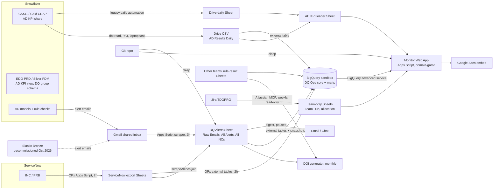

# 05 · Integrations: what we connect to today, and where a new DQ tool could plug in

Context file for the DQ tools deep-research brief. As of **2026-10-18**.

Every statement is labelled **TODAY** (running or verified in the workspace) or **POSSIBLE / PROPOSED** (designed, planned, or inferred from what exists). Nothing here names people, credentials, account locators, file or deployment IDs, or internal URLs. Roles are used instead of names.

---

## 0. The one constraint that decides most tool choices

**InfoSec data path (TODAY, binding).** The line is **dbt versus third-party native apps**, not files versus warehouse.

- **dbt connecting to Snowflake is approved.** It runs read-only over Globe's PrivateLink with Okta SSO, or with a personal access token for scheduled jobs.
- **A third-party application that opens its own connection to a production database needs a lengthy security approval.** This is why DQOps (live JDBC) was treated as gated and likely skipped.
- **The zero-approval substrate** is Snowflake → GCP storage → Google Sheet → CSV / flat file. Apps Script and Sheets on Google Workspace sit on this path.
- **BigQuery is now the system of record for DQ data** (decided 2026-10-03). Machine pulls should land in BigQuery directly. Sheets survive only as human entry forms, or for per-person team data, which stays out of BigQuery on purpose because BigQuery is visible across TDG.
- **Apps Script writing into BigQuery** was approved by the Head of DQ Ops into a landing dataset only, with no separate InfoSec ask, while on the sandbox. The ingestion plan still recommends one InfoSec confirmation before that write path scales.
- **Target-architecture position:** "Do not buy a catalog or DQ SaaS. DataHub is ISG-owned and exists; third-party apps opening their own DB connection stay InfoSec-gated." A new tool has to clear this sentence, or change it with evidence.

**What this means for tool research:** a tool that runs **inside** a platform we already use (dbt package, Snowflake-native feature, BigQuery-native feature, GCP service) is far easier to adopt than a SaaS or self-hosted app that needs its own warehouse credential.

---

## 1. Current integration map (TODAY)

### 1.1 Table

| # | System | Role for DQ Ops | Direction | Mechanism | Cadence | Owner | Status and limits |
|---|---|---|---|---|---|---|---|
| 1 | **Snowflake CSSG account** (Gold / CDAP marts; also receives the AD KPI share) | Source of AD model output; ad-hoc profiling and spot checks | Read | **dbt** (dbt-core + dbt-snowflake) over PrivateLink. `dbt show --inline` wrapped by the `snowflake-pull` skill (read-only guard: single SELECT only) | On demand; plus the 6-hourly AD export | Platform owns account; DQ Ops reads under a personal role | Live. Needs Globe network or VPN. SSO re-prompts each run (no token caching). Scheduled use needs a PAT on one laptop |
| 2 | **Snowflake EDO PRD account** (Silver / FDM) | Native home of the AD KPI view; holds a DQ Ops group schema where our role owns tasks; chosen home for new interim checks | Read (planned write of check results) | Same Okta login. A dbt target was added. **No GCS storage integration** on this account (only S3 and an email integration). Creating one needs an account admin | Not yet scheduled | Platform admins own integrations | Verified 2026-10-04 by SHOW/DESC. Our proven dbt profile is CSSG and cannot reach the FDM database, so a PRD connection still has to be established for checks |
| 3 | **Snowflake AD models and DMFs** | Run the Silver/Gold anomaly-detection and rule checks; send alert emails | Snowflake → email | Snowflake-native jobs emit "KPI Anomaly Monitoring" and "Data Quality Check Failure" emails | Daily / per run | Other CDA teams own the jobs | Live. About 230 credits a month for DQCs. Results reach us only as **email text** |
| 4 | **AD KPI export** | Feeds the KPI Anomaly Monitor | Snowflake → Drive → Sheet | (a) Legacy: a Snowflake automation writes a daily Google Sheet into a Drive folder. (b) Ours: PowerShell producer runs dbt with a PAT, writes a raw 90-day CSV to a Drive-for-Desktop mounted Shared Drive. Windows Task Scheduler job. On-demand twin: `ad-kpi-export` skill | (a) daily; (b) 4 times a day (00/06/12/18) | DQ Ops | Live. **Depends on one laptop being on and logged in.** Data is D-1 for IN Summary, D-3 for CWN/Delphi (model lag, not export lag) |
| 5 | **AD KPI loader** (Apps Script, sheet-bound) | Curates the AD window, builds a precomputed "served" sidecar tab | Drive → Sheet | Picks the fresher of the 6h CSV or the legacy daily Sheet, filters active rows and 90 days | 6-hourly trigger | DQ Ops | Live. Some steps are menu-only (clasp cannot run functions) |
| 6 | **Gmail** (shared alert inbox) | **Primary detection intake.** Snowflake AD, rule-check and (until Oct 2026) Elastic alert emails | Gmail → Sheet → BigQuery | Apps Script `scraper` reads every sender-matching message per thread, dedupes by message ID, writes Raw Emails; `parser` turns them into alert rows; a denylist drops non-DQ mail | Two-hourly grid, 8 runs, 05:30 to 19:30 | DQ Ops | Live. Brittle by nature: free-text parsing, thread grouping, reply re-parses. See pain points |
| 7 | **ServiceNow** (INC, PRB, CHG) | Incident system of record | ServiceNow → export Sheet → our Sheets and BigQuery | **No direct API.** The OPx lead's Apps Script producers pull ServiceNow into a shared Sheet (a direct-pull tab plus a consolidated report tab, every 2 hours). Our `scrapeAllIncs` joins them into one All INCs sheet. The OPx lead's BigQuery dataset also loads the export Sheet via external tables and scheduled queries | Producers 2-hourly; our sweep 2-hourly at :30 | OPx lead (producer); DQ Ops (consumer) | Live. ServiceNow integration user requested, pending approver since 2026-09-01. Export has no SLA due/target date |
| 8 | **Problems tab** (PRB register) | PRB coverage, alert-to-PRB matching | Human → Sheet → BigQuery | Hand-maintained Sheet tab, snapshotted to BigQuery with change hashes | On edit; snapshot every 2h | DQ Ops | Live. Keeps only current PRBs, so PRB trend history starts Oct 2026 |
| 9 | **Other teams' rule-result Sheets** (Gold retro-check score, Silver report_data working tabs) | Inputs to the monthly DQI layer scores | Sheet → Apps Script / BigQuery external tables | DQI generator reads them; BigQuery reads them as external tables | Monthly (day 11, 06:00) | Owning teams | Live. A Sheet hop over another team's Snowflake output |
| 10 | **IN Summary report Sheet** (report team) | Per-brand / per-channel drilldowns | Sheet → mirror Sheet | A separate mirror Apps Script project copies the report tab and computes Median+MAD bounds | Daily | Report team owns source | Live but fragile: the wide tab DQ Ops still reads has been frozen since late July; live data moved to three long tabs |
| 11 | **BigQuery (GCP sandbox project)** | **DQ result-and-evidence store; serving layer for Monitor v2** | Sheets / Drive CSV / OPx tables → BigQuery → Web App | External tables over Sheets and the Drive CSV; hash-gated raw snapshots; stored procedures build core and mart tables; the Apps Script verdict classifier and flat engine are ported **verbatim** as JavaScript UDFs. Scheduled queries: refresh every 2h, narratives every 15 min, freshness watchdog hourly with failure email | 2-hourly | DQ Ops (sandbox; platform owner = DPE) | **Live behind Monitor v2 since 2026-10-07.** Runs on one person's credential, no service account. Cloud SDK cannot read Drive-backed tables (Workspace policy drops the Drive scope), so snapshots only run from console-created scheduled queries. Production GCP arrives with LEAP |
| 12 | **TDG Data Quality Monitor** (Apps Script Web App, embedded in Google Sites) | The audit / governance / exec surface | Sheets and BigQuery → browser | `google.script.run` (same-origin). Code.gs reads Sheets server-side and queries BigQuery through the BigQuery advanced service, returning the same string shapes the frontend already parses. Domain-gated `/exec` URL is the only data path; source Sheets are Restricted | Reads on page load; caches and a cache-warmer | DQ Ops | Live (latest publish 2026-10-16). Apps Script quotas: 6h/day runtime, 30 concurrent executions per user |
| 13 | **clasp** | Deploy pipeline for 5 Apps Script projects (plus lineage and onboarding apps) | Repo → Apps Script | `deploy.sh`: pull-first, overwrite mapped files, `push --force`; `publish` redeploys the live Web App version in place | Per change | DQ Ops | Live. Cannot run functions headlessly; triggers and menu steps stay manual. Ships any uncommitted WIP unless a drift-check is done first |
| 14 | **Email out: Open-Incident Digest** | SOD/EOD digest of open incidents and open PRBs, CSV attachment | Sheet → Gmail | Apps Script `notify` with HTML email (Google Chat card supported by a webhook property) | Designed 07:30 / 18:00 | DQ Ops | **Code deployed, PAUSED.** Recipients not confirmed, triggers not installed |
| 15 | **Gemini from Apps Script** | Narrative headlines and tooltips on the Monitor | Sheet data → Gemini → NARRATIVES tab → BigQuery | Apps Script calls Gemini at the end of each refresh | Each refresh; BigQuery copies every 15 min | DQ Ops | Live. Vertex AI API is not enabled on the sandbox (would need an ask) |
| 16 | **Jira (TDGPRG project)** | Team allocation and work tracking for the Team Hub | Jira → CSV → team-only Sheet | `dq-teamhub-refresh` skill pulls Jira via the **Atlassian MCP** (read only, never writes), plus the talent allocation register via a Drive xlsx export; builds 6 CSVs; a bound importer script loads them | Weekly, run by hand | DQ Ops | Live. Per-person data, deliberately never in BigQuery or Jira labels |
| 17 | **Google Drive MCP and Drive for Desktop** | Ad-hoc reads of Sheets; file drops into Drive | Drive ↔ local | Read via xlsx export (never the text flatten, which corrupts numbers); write by copying into the mounted drive | Ad hoc | DQ Ops | Live. Inspection only, **never a pipeline path** for Restricted production sheets. xlsx → native Sheet conversion stays manual |
| 18 | **Gmail MCP** (Control Files label) | Control Files tracker refresh | Gmail → agent team → HTML tracker | `control-files-refresh` skill pre-scans the label, spawns only platform agents with thread activity, proposes edits for approval | On request | DQ Ops | Live. Implementation tracking only; incidents are out of scope |
| 19 | **Data Lineage explorer** | Column-level Bronze → Silver → Gold trace, with open INCs mapped to nodes | Mapping docs + view SQL + incident feed → standalone Web App | Python builders produce a JSON model; deployed as its own domain-gated Apps Script Web App via clasp | Rebuilt per onboarding | DQ Ops | Live since 2026-07-02. One report (IN Summary) onboarded. Not connected to DataHub |
| 20 | **dbt check catalog** (`checks.yml`) | Registry of 506 checks (481 rule checks + 25 MRD contract checks) | Repo only | YAML registry, `dq-author-check` skill, dbt generator designed | n/a | DQ Ops | **Design only for execution.** No `dbt test` running against live tables yet |
| 21 | **Elastic / Kibana** | Bronze ingestion monitoring (record and error counts, hourly AD, Chat alerts) | Elastic → email → our scraper | Alert emails into the shared inbox | Hourly | DataOps / Managed Services | **Decommissioned for Bronze from Oct 2026.** Monitor greys Bronze ("Paused, no AD tool") |
| 22 | **DataHub** | Enterprise metadata / lineage catalog | None today | n/a | n/a | ISG Data Governance | Exists; **we do not integrate with it** |
| 23 | **GEDM** (enterprise data model, on Confluence) | Reference for domain / entity mapping | Confluence → KB markdown | Distilled once into the knowledge base; used best-effort in the `dq-owner-request` skill | Pulled 2026-10-09 | Data Architects; governed by EDG | Reference only; pages last edited Dec 2024; policy unratified |
| 24 | **Genesis** (vendor agent platform) | Cerberus, the DQ Ops agent spec | Planned read of our GCP project | OAuth per individual user, not service accounts | n/a | Onboarded via DPE | **Provisioned 2026-10-02.** Connections and scheduling not yet confirmed. Nothing running |
| 25 | **Clairvoyance** (Grafana) | Enterprise-mandated data observability; auto-raises ServiceNow INCs | Planned | n/a | n/a | Clairvoyance team | **Onboarding pack built 2026-10-15, not sent.** Nothing connected |
| 26 | **Claude Code** | Authoring and engineering layer (check drafting, SQL pulls, GAS deploys, lineage builds) | Local | Skills + 4-agent team; MCP connectors (Atlassian, Drive, Gmail) | Daily | DQ Ops | Live. AI authors and interprets; engines execute; never pointed at live DBs for writes |

### 1.2 Diagram (TODAY)

Plain-text summary of the flow: **Snowflake checks speak by email; ServiceNow speaks through another team's export Sheet; everything is joined in Apps Script, mirrored into BigQuery, and served by an Apps Script Web App.** BigQuery is now the serving source for most panels, but almost every BigQuery input still arrives through a Sheet.

---

## 2. Integration pain points (TODAY)

1. **Detection arrives as email text.** Gmail thread grouping once silently dropped later alerts in a thread; analyst replies quoting an INC created duplicate rows; same-sender non-DQ mail had to be denylisted. Attribution exists only as prose.
2. **Attribution is inferred from free text.** About five interacting mechanisms (text-pattern source inference, multi-INC fan-out, orphan backfill, duplicate merge, full re-parse) exist only because INCs lack structured source, table and rule fields. The target architecture calls this the largest recurring maintenance cost.
3. **No direct ServiceNow access.** The export's direct-pull tab sometimes appends a new row per ticket change, and our index kept the first row: in one sample about 28 tickets showed a stale state, 11 lost resolution notes, 11 lost the resolved date. State was fixed 2026-09-22; notes and resolved date still read the first row. The two export tabs can disagree. No SLA due date in the export. A ServiceNow permission change blocked the scraper for a period in July (resolved).
4. **Stacked refresh latency.** ServiceNow → export (2h) → our sweep (2h) → BigQuery refresh (2h) → Web App cache. Drive "modified time" cannot diagnose cadence; only execution logs can.
5. **Single points of failure.** The 6-hourly AD export runs on one laptop, only while logged in. A Shared Drive rename silently broke it for two days in July. BigQuery refresh, the Web App and triggers run on one person's account, the OPx producers on another's. No service accounts.
6. **Drive-scope block.** Workspace policy drops the Drive scope for the Cloud SDK, so Sheet-backed BigQuery tables can only be read by console-created scheduled queries.
7. **Snowflake → GCS is not plumbed.** EDO PRD has no GCS integration (account-admin ask); the CSSG self-serve route is on hold pending two grants; the CHM export pattern was manual, erroring at handover, and wrote to another team's GCP project.
8. **Manual steps clasp cannot do:** running loaders, installing triggers, rebuilding tabs after deploy, sending the digest, xlsx → Sheet conversion.
9. **Sheet-specific bugs.** Timestamp strings re-typed as dates (every row read as "changed"); blank "Opened" cells silently dropped about 29 closed incidents.
10. **Anomaly detection without plausibility.** The rolling-window AD model missed an 83× broadband-usage inflation for over eight months. Rule checks out-yield statistical AD about 7× on actionable incidents.
11. **No Bronze coverage** from October 2026 (Elastic decommissioned). DataOne is unreachable from Snowflake.
12. **No outbound alerting in production.** Digest paused; no Chat or ServiceNow push; Clairvoyance not connected.
13. **Check execution is not automated.** The registry is versioned but not executed by dbt yet.
14. **Catalog and lineage are islands.** Our explorer and GEDM copy are not linked to DataHub.

---

## 3. Possible integrations for a new DQ tool (POSSIBLE / PROPOSED)

Feasibility is rated against the InfoSec data path:
**High** = runs inside an approved platform or path, no new approval class.
**Medium** = needs a known, bounded ask (grant, integration user, InfoSec confirmation).
**Low** = third-party app opening its own production-DB connection, or depends on things not yet existing.

### 3.1 Snowflake (Silver FDM, Gold CDAP)

- **What exists:** approved dbt read path; a DQ Ops group schema on EDO PRD where our role can create tasks (decision D4: new check config, procs and results go there "for the time being"); Snowflake DMFs considered acceptable as a native feature; CHM daily logs as a working prototype of "checks run in Snowflake, results in a separate table". Proposed D6: dbt Core writes and compiles checks, Snowflake tasks run them.
- **What a tool must support:** execute **as dbt tests or dbt packages** (for example dbt-expectations or Elementary-style models) or as Snowflake-native SQL/DMFs/tasks; write results to a Snowflake results table; no separate JDBC connection from a vendor runtime; work with Okta SSO for humans and a non-interactive credential for schedules.
- **Feasibility:** **High** for dbt-native or Snowflake-native engines. **Low** for SaaS or self-hosted tools with their own live connection (same class as DQOps).
- **Dependencies:** a dbt connection to EDO PRD (today's proven profile is CSSG only); a non-interactive credential for schedules; a writable schema; the D6 decision.

### 3.2 Snowflake → GCS → BigQuery (results transport)

- **What exists:** the approved substrate minus the Sheet hop. Pattern known from CHM (storage integration, external stage, `COPY INTO` as a task). Decision D3: a new bucket in our GCP sandbox. BigQuery loads directly from GCS, which sidesteps the Drive-scope block.
- **What a tool must support:** emit results as files (CSV/Parquet/JSON) to GCS, or as a Snowflake table we export ourselves.
- **Feasibility:** **Medium.** No InfoSec class change, but a storage integration on EDO PRD is an account-admin ask (or likely delivered through LEAP).
- **Dependencies:** account-admin integration; GCS bucket; replaces the laptop AD export too.

### 3.3 BigQuery, Dataplex and GCP-native execution

- **What exists:** BigQuery is the DQ result-and-evidence store and already serves Monitor v2. The target architecture names dbt on BigQuery for marts, Dataplex for GCP-resident Bronze (P3), and BigQuery-native DQ on DataOne as the one place BigQuery becomes an execution engine (P3 / 2027). Production GCP comes with LEAP; 2026 work runs in the sandbox. A Cloud Run serving path and Vertex AI are both deferred.
- **What a tool must support:** read and write BigQuery natively; land results in a designated landing dataset (never in the marts); run as GCP-native (Dataplex data quality scans, BigQuery SQL, dbt-bigquery) under GCP IAM; export results in a shape our marts can absorb (rule id, dataset, table, column, records evaluated, records failed, run id, timestamp).
- **Feasibility:** **High** for GCP-native features inside our project. **Medium** for anything needing Cloud Run, service accounts or new APIs (deploy roles and Vertex are not granted on the sandbox). Bronze/DataOne execution is **Medium-to-Low** today because it depends on LEAP landing zones.
- **Dependencies:** LEAP production GCP; service accounts via DPE or LEAP; the DataOne coverage decision.

### 3.4 dbt (check authoring and execution)

- **What exists:** the `checks.yml` registry (506 checks, six generic test types designed), the `dq-author-check` skill, a dbt generator design, and a plan for GitLab CI to run `dbt test` on merge requests with AI review of rule diffs. Pipeline Engineering also uses dbt for integration and consumption contracts.
- **What a tool must support:** compile from or into a YAML registry; dbt-native tests; CI-runnable; threshold-based results (not just pass/fail), since Framework thresholds are percentages.
- **Feasibility:** **High.** This is the approved path and the current design direction.
- **Dependencies:** EDO PRD dbt connection; CI runner; registry engine field (D1: every check family in one registry).

### 3.5 ServiceNow (incident ingest and creation)

- **What exists (ingest):** export Sheet consumed every 2 hours; a direct ServiceNow Table API pull is designed (scheduled job → GCS/BigQuery) and **gated on a read-only integration user** (on `incident`, `problem`, `change_request`), pending since 2026-09-01. Incidents are the source of truth for alert parity (decision D26).
- **What exists (creation):** nothing from our side. Target: **Clairvoyance auto-raises INCs**. A time-boxed design window asks that the auto-raised INC carry structured fields: correlation/run id, rule id + contract version, error code, dataset / source system / table / column, records failed / evaluated, severity, action taken, assignment group = source partner. If those land, our inference layer is deleted.
- **What a tool must support:** either (a) emit structured events that Clairvoyance or ServiceNow can turn into INCs with those fields, with **correlation and dedup before raising** (one root cause, one ticket), or (b) not raise tickets at all and leave that to Clairvoyance. A tool that raises its own tickets directly would create a second alerting path, which the target architecture rejects.
- **Feasibility:** ingest **Medium** (integration user pending); tool-raised INCs **Low** (conflicts with the Clairvoyance mandate unless routed through it).
- **Dependencies:** integration user; INC template field mapping; Clairvoyance onboarding.

### 3.6 Clairvoyance (Grafana)

- **What exists:** enterprise-mandated alarm and observability surface that reads BigQuery and auto-raises ServiceNow INCs. Target: two surfaces, one semantic layer (Clairvoyance for alarms, the Monitor for audit and evidence). Proposal to compile alert rules from data contracts, which **depends on Clairvoyance supporting rules-as-code** (unconfirmed). Onboarding pack asks Clairvoyance to read AD results directly from Snowflake tables (flagged as likely needing InfoSec approval); signals offered are metrics and logs, no traces.
- **What a tool must support:** publish metrics and results to BigQuery tables (or a Grafana-readable source) so Clairvoyance alarms on them; not duplicate alarming; optionally generate alert rules as code.
- **Feasibility:** **Medium.** Path is clear in principle; open questions on datasource location, rules-as-code, notification channels and chargeback.
- **Dependencies:** onboarding pack sent and accepted; hosting tower; user roles.

### 3.7 Jira, Google Workspace, email

- **Jira:** used only for team allocation (read-only, weekly). Incidents live in ServiceNow, so a Jira connector is low value. The LEAP user stories' "fully covered" scoring leaned on PagerDuty/Slack/Jira/Soda/GE tooling that is neither Globe's (ServiceNow, Clairvoyance) nor Pipeline Engineering's (dbt, Google Chat). Treat Jira-first pitches as non-differentiating.
- **Workspace:** Sheets survive as human entry forms with BigQuery keeping history. Google Chat cards exist in the paused digest, and Pipeline Engineering's contract sample uses a Chat webhook. A tool may notify by Chat or email, and must not require copying Restricted Sheets out of the domain.
- **Email:** detection-by-email is to be retired per source in favour of direct result-table pulls into BigQuery. Email output from a tool is a convenience, never the integration contract.
- **Feasibility:** **High** for all three.

### 3.8 Catalog and lineage (DataHub, GEDM, our explorer)

- **What exists:** DataHub (ISG-owned) is the enterprise catalog; the target says "we register, we don't compete" and plans to register our BigQuery datasets there (P3). GEDM is reference material on Confluence (policy unratified). Our lineage explorer covers one report. No Collibra-type commercial catalog is in use.
- **What a tool must support:** read lineage and ownership from DataHub (or push DQ results to it) rather than bring its own catalog; accept a table registry seeded from our ref tables.
- **Feasibility:** **Medium** (DataHub integration needs ISG cooperation). Buying a separate catalog is **Low** (explicitly out of the target).

### 3.9 Genesis / Cerberus

- **What exists:** Genesis provisioned; Cerberus spec submitted. Cerberus reads our GCP project read-only and returns judgement and language (rank coverage gaps, screen RCA for evidenced vs asserted cause, explain the score). It **never computes or publishes a number** and stays out of check execution. It drafts interim monitoring checks from the approved check-type library for a person to approve. Genesis OAuth runs on individual user credentials; blueprints are the guardrails; changes gate on GitHub PRs; Claude skills can be imported; it has a "Prover" validation UI.
- **What a tool must support:** expose results in BigQuery (or via API) that an agent can read; keep computation in the tool or dbt, not in the agent; versioned rule definitions an agent can draft as diffs.
- **Feasibility:** **Medium.** Which connections Genesis has, and whether missions can be scheduled, are unconfirmed. Overlap with Vertex AI as the narrative layer is an open decision.

### 3.10 Claude and AI-assisted authoring

- **What exists:** Claude Code as the authoring layer (skills for check authoring, Snowflake pulls, lineage onboarding, owner requests). Rule: AI authors and interprets; engines execute; design and test on dummy schemas. Claude is GA on both AWS Bedrock and GCP Vertex AI. Gemini runs narratives today; Gemini Gems are proposed for team-facing knowledge.
- **What a tool must support:** rule definitions as plain text (YAML/SQL) in Git so AI can draft and review diffs; no requirement to send production data to a vendor AI service. Vendor "AI rule generation" features must work on metadata, or be switched off.
- **Feasibility:** **High** for Git-based rules. Vendor-hosted AI that reads production data is **Low** without approval.

### 3.11 Data contracts (ODCS v3.1.0)

- **What exists:** our DQ-section spec (seven blocks; Block E fallout records, Block F per-run quality logs with `checkResults[]` and full received/processed/passed/failed/loaded counts, Block G incident integration; a 31-code error matrix as the cross-pipeline aggregation key). Contracts now apply only at ownership boundaries. One MRDE contract in true ODCS on BigQuery is proposed as the DQ-subsection pilot; its 25 checks are already in our registry as `engine: contract`. DGM/DFM owns the standard; there is no central contract registry yet (GitLab proposed).
- **What a tool must support:** ingest ODCS YAML quality blocks and generate checks from them; emit fallout and run logs in the contract's shape (run id, rule id, contract version, action taken, records evaluated / failed, error code).
- **Feasibility:** **High** if the tool is file/YAML-driven; the dependency is organisational (contract ratification), not technical.

### 3.12 Bronze (AWS S3, GCP DataOne, network feeds)

- **What exists:** no coverage from October 2026. The replacement direction is LEAP anomaly detection on ingestion. CDA's reach is Snowflake-only; network data's landing system is unconfirmed.
- **What a tool must support:** run where Bronze lives (GCS / BigQuery for DataOne; AWS-native for S3) and push results to our BigQuery store; volume and freshness checks against control files (our 99.7% control-file target).
- **Feasibility:** **Medium** for DataOne via GCP-native tools once LEAP lands; **Low** for AWS S3 from our side today.

### 3.13 Summary grid

| Integration point | Tool must support | Feasibility | Key dependency |
|---|---|---|---|
| Snowflake execution | dbt tests / Snowflake-native SQL, DMFs, tasks | High (native) / Low (own connection) | EDO PRD dbt connection; D6 |
| Snowflake → GCS → BQ | File or table results we can export | Medium | Account-admin storage integration / LEAP |
| BigQuery / Dataplex | Native read/write; landing dataset | High (native) / Medium (Cloud Run, SAs) | LEAP production GCP |
| dbt | YAML registry, CI, thresholds | High | CI runner |
| ServiceNow ingest | Table API consumer | Medium | Integration user |
| ServiceNow creation | Via Clairvoyance, structured fields, dedup | Low (direct) | INC template mapping |
| Clairvoyance | Results in BQ; rules-as-code optional | Medium | Onboarding; rules-as-code confirmation |
| Jira | Not needed for DQ | High / low value | n/a |
| Workspace / Chat / email | Notifications only | High | n/a |
| DataHub / GEDM | Read lineage, register results | Medium | ISG cooperation |
| Genesis / Cerberus | Readable results; Git rules | Medium | Genesis connections |
| Claude authoring | Rules as code in Git | High | n/a |
| ODCS contracts | Generate checks; emit fallout/run logs | High (tech) | Contract ratification |
| Bronze | Run in GCP/AWS where data lives | Medium / Low | LEAP |

---

## 4. Integration requirements checklist for evaluating tools

Use this as a pass/fail and scoring sheet. Items marked **must** come from binding constraints; the rest are strong preferences.

1. **Must: no vendor runtime opening its own connection to production Snowflake or other production DBs**, unless the vendor accepts a full InfoSec review. Prefer execution as dbt, Snowflake-native, or BigQuery/GCP-native.
2. **Must: results land in BigQuery** (our system of record) in a landing dataset, as structured rows: run id, rule id + version, dataset, table, column, records evaluated, records failed, threshold, severity, action taken, timestamp.
3. **Must: no Sheet or email as the integration contract.** Email/Chat notifications are allowed as extras.
4. **Must: does not create a second alerting or ticketing path.** Alarms go through Clairvoyance; INCs are auto-raised there. If the tool can raise events, it must support correlation/dedup before raising.
5. **Must: rules as code in Git** (YAML or SQL), reviewable by merge request, compatible with our `checks.yml` registry and its `engine` field.
6. **Must: threshold-based results** (percentages, not just pass/fail), so EDS-AG Framework thresholds apply.
7. **Must: works on Google Cloud** (BigQuery, GCS, Dataplex) for the LEAP target, and with Snowflake for the interim.
8. **Should: dbt-native** or able to compile to dbt tests, runnable in GitLab CI.
9. **Should: plausibility checks, not only change detection** (absolute range bounds, per-entity ratios, same-day-of-week comparisons), given the rolling-window blind spot.
10. **Should: ingest ODCS v3.1.0 contract quality blocks** and emit fallout records and run logs in the contract's shape, keyed by a shared error-code matrix.
11. **Should: non-interactive identity model** that fits GCP IAM service accounts (when LEAP provides them) and Okta SSO for people; no long-lived keys in code.
12. **Should: Bronze reach** for GCP DataOne (and ideally AWS S3), including control-file / manifest reconciliation.
13. **Should: lineage and ownership read from DataHub** rather than a new catalog; no requirement to buy a catalog.
14. **Should: AI features that work on metadata**, with the option to keep production data out of vendor AI; outputs readable by Genesis/Cerberus and Claude.
15. **Should: observable** (run logs and failure metrics that Clairvoyance or Cloud Monitoring can watch), so stale data is not noticed by a person first.
16. **Should: cost visible per check or run** (warehouse credits / BigQuery slots), since Snowflake checks already cost about 230 credits a month.
17. **Check: approval path and lead time.** Record which items need an account-admin grant, a ServiceNow integration user, DPE / LEAP provisioning, or InfoSec review, and how long each takes. The target architecture notes these are "weeks to months" and that the org clock, not the spend, is the usual obstacle.

---

## Sources

Workspace: `projects/DQR/CLAUDE.md`, `projects/DQR/context.md`, `projects/DQR/ag-dqr-app/DEPLOY.md`, `projects/dq-checks/README.md`, `projects/Data Lineage/CLAUDE.md`, `projects/DAQO Agents/context.md`, `projects/Control Files/CLAUDE.md`, `.claude/skills/{snowflake-pull, ad-kpi-export, dq-teamhub-refresh, dq-owner-request, control-files-refresh}/SKILL.md`, `knowledge base/reference/data-estate-and-systems.md`, `_wip/Future-State/01-Target-Architecture/00-TO-BE-Architecture-Review.md`, `_wip/Future-State/07-BQ-Data-Layer/15-INGESTION-TRANSITION-PLAN.md`.

Plus the DQ Ops memory pool (integration, InfoSec, BigQuery, ServiceNow, Snowflake, Genesis, Clairvoyance and contracts notes).
